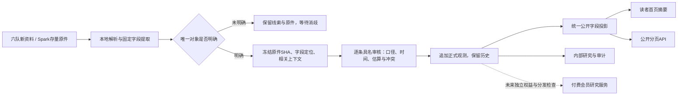

# 来源优先的对象观测

现行规则：[01 数据口径](../../framework/01_data_standards.md)、[06 采集](../../framework/06_acquisition.md)、[公开字段清单](../../framework/research_publication.json)。本指南不以运行成功代替语义审核或上线回执。

## 身份与时间

园区沿用物理站点 `site_id`。公司使用已登记法人ID；产品由厂商、确切型号、版本确定；统计由发布者、系列、地区、定义确定；报价由卖方、完整配置、市场、币种及计价条件确定。未能唯一匹配的资料保留在线索层，不能靠同名或同城并入对象。

每条观测分别保存有效时间 `effective_at`、来源披露时间 `source.published_at`、首次有记录接收时间 `source.first_received_at`、实际审核时间 `reviewed_at`、正式写入时间 `recorded_at`。未知留空，年/月精度保留，不拿下载日期代替信息日期。当前值只在有效时间可确定先后时选择；未知、预测及未来值单列，同口径冲突并列。原生区间不取中点；修订/撤回保留旧版本和明确替代链。

## 本地操作

运行数据放在现有资料根，不将原件或SQLite提交到Git。

1. 针对归档JSON制定选择器计划：原件SHA、唯一对象、字段JSON Pointer、口径和已知时间。运行 `python3 manage.py object-extract --plan PLAN.json --data DATA_ROOT --output CANDIDATES.json`。提取使用Python标准库，无模型调用，不产生采用。
2. 对JSON或已定位的原生HTML/PDF页运行 `python3 manage.py object-review prepare --input CANDIDATES.json --data DATA_ROOT --output PROPOSAL.json`。入口重核真实原件、定位、相关上下文及首次接收记录，冻结审核版本。
3. 实际审核者检查主体、值、表头/脚注、单位、工况、时间和冲突，填写现行C3记录；允许公开的字段同时明确 `public_fields_reviewed=true`。普通新增批次不重复要求所有者确认；替代旧结论和放宽受限分发仍遵守01。
4. `python3 manage.py object-review apply --input PROPOSAL.json --data DATA_ROOT` 在锁内复验原件和冻结版本、CAS追加 `data/object_observations.json`。完全相同的提案重放不重复计数、不刷新接收/写入时间。
5. 通过严格校验、registry、治理与相应测试后按原单一发布队列部署，核正式镜像内数据与公网实际返回。

没有模型需求也可完成上述步骤；它们不会自动把目标标为delivered、关闭问题或验证模型参数。

## 网页与API的同一公开范围

`GET /api/observations?limit=50&offset=0` 返回经审核的公开研究投影，支持 `object`、`type`、`company` 筛选。每页最多100条，`next_offset` 为后续页；`type` 可为 company/product/statistic/quote。首页同样消费 `public_records`，仅限制摘要数量，不另设内容权限。

公开范围包括唯一对象、数值/区间、单位、性质、条件、信息/披露/核实时间、来源链接、冲突和修订。原件引文、上下文SHA、接收审计、审核委托及本机路径不直接序列化；私有记录也不计入公开总数。原始账本路径不匿名开放。付费会员不是现有内部 `member`，本批没有支付或会员权益服务，不能以付费名义取得后台权限。

## 首批真实采用范围

Spark归档实际核验13份原件，采用81条：68条产品规格、3条公司与产品关系、10条EIA工业电价统计，共18个对象。提取模型调用0，语义审核为本会话实际具名审核；全年/月累计均价不当作数据中心报价，厂商额定规格不当作园区实测。

7条继续保留待核：Delta 33kW BBU六项既有映射值没有在所选归档原生正文找到；Vertiv Li7一项能量字段的原标签与解释不一致。真实报价采用0。没有因此增加全文阅读数或已验证模型输入数；171项未接通来源和17个未验证模型输入不被本批改状态关闭。实际部署状态以本批交接及私有运行回执为准。

归档HTML若将规格内联保存在iframe[srcdoc]，可用`html:srcdoc:N`（从1开始，仅计带srcdoc的iframe）定位相关片段。标准库解析属性转义及内层文本，不执行JavaScript、不访问外部iframe；大小/定位/空白内容拒绝。原始HTML字节SHA和选定文本上下文SHA同时冻结，逐条引文须存在于所选片段。普通正文及PDF继续用原页定位；这不是全文阅读完成，也不授予模型支持。表格列、额定条件、脚注及公开资格仍须具名审核。
