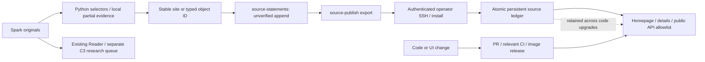

# Independent ordinary source publication — 2026-10-12

Read framework/CURRENT.md and current_state.json first. Ordinary source registration is not factual verification or C3 research adoption. Stable identity, structural validity, independent clocks, history, source references and public field boundaries remain. Never delete originals or restart the existing Reader.

## Actually published

- PR858: three campus identities, five v3 source observations. 149 project records /34 site observations. Actual homepage/details/mobile acceptance: 2026-10-12 13:57:43 Asia/Shanghai. Earlier three ordinary site statements were already counted; do not recount them.
- PR859: independent persistent source publication and ordinary company/product/statistic/quote intake. PR860 fixes legacy baseline export and company-page source timelines; deployment must be verified against actual receipts.
- Two data-only imports: 148 +532 =680 typed records. Company652, product26, statistic1, quote1. These are unverified ordinary source statements, not 680 reviewed research adoptions. Historical baseline81+89=170 remains historical; old typed public545 is unchanged. Public total1225 records /805 objects. This phase adds five campus statements +680 typed statements =685 new source records. Cumulative ordinary site8 +typed680 =688.
- First data import: 0.264701s; second: 0.444885s. Both have production replay new_records=0. No data PR/Actions/image builds. Extraction and registration batch1: 10.35675s +15.092604s; batch2: 42.742909s +56.966408s. No model calls. Counts derive from live record IDs, not candidates or extraction text spans.
- Data survives code releases in /runtime/data/raw/source-publication/registry.json, mounted from /srv/inresearch.ai/data. Source baseline data/object_observations.json remains Git545; the runtime projection adds680. Do not overwrite a runtime ledger with a Git release file.

## Execution and receipts

M5 active worktree: /Users/m5/.codex/worktrees/site-observation-evidence/inresearch.ai. Never switch/stash/stage/overwrite /Users/m5/code/inresearch.ai. Spark canonical code: /home/spark/code/inresearch.ai. Originals: /home/spark/.local/share/inresearch.ai.

Private receipts on M5 and Spark: ~/.local/state/inresearch.ai/runtime-source-publication-20261012/. See acceptance.json, registration-receipt.json, batch2/*, production-install.json, production-replay.json, final-website-acceptance.json and followup-deployment.json when present. Root reporting watermarks remain ~/.local/state/inresearch.ai/stock-expansion-20261011/progress.json and acceptance.json; historical receipts are retained, not replaced by new totals.

Source preparation dataset on Spark: ~/.local/state/inresearch.ai/runtime-source-publication-20261012/checkout. Its data contains native baselines plus680 ordinary typed additions; do not recreate it from Git and lose the ordinary history. Use current canonical Python code with --root pointing at the authoring dataset; synchronize only code/framework as needed and preserve data. Existing scripts build-batch.py/build-batch2.py are replayable private extraction examples, not a daemon. Batch2 normalized duplicate company names rather than creating more IDs. Existing company IDs and selected legal-name aliases are reused. Parent/subsidiary identities must not be merged by similarity.

Spark mirror also exists in ~/.local/share/inresearch.ai/data/raw/source-publication/registry.json. Read it using INRESEARCH_RUNTIME_ROOT=/home/spark/.local/share/inresearch.ai. This is a data mirror, not another public website or another C3 publication queue. Replay must return zero additions.

To publish ordinary data: source-publish export --root AUTHORING_ROOT --output PRIVATE_BUNDLE; transfer via existing authenticated SSH; pipe the bundle to `sudo docker exec -i inresearch-host-inresearch-1 python3 manage.py source-publish install` on aws. Structural failures commit nothing; never patch an old record or bypass a failure. Existing reviewed site baselines are omitted by the current exporter. Then verify all added IDs via paginated /api/observations or /api/industry, homepage marking, unchanged old records, replay and service/image health. The fixed public allowlist excludes quotations, archive provenance and paths. Install receipts are not HTTP acceptance.

The owner explicitly requires hourly Chinese reports, including unchanged-state reports with measured time/blockers. Report source registration, C3 adoption and actual publication separately. The original single research coordinator was restored after acceptance; PID17306 at 2026-10-12 14:05 Asia/Shanghai. The task-owned stop-coordinator marker was removed. Do not leave it paused or start a competing Publisher. Research PRs retain protected checks; ordinary data imports do not need PRs.

## Next work and actual remaining limits

Continue deterministic local extraction from Spark stock; do not stop at these names or reopen full-document/model-use prerequisites. 671 literal full company-name cells yielded652 normalized names in this batch; this does not mean all workbook information was extracted. Preserve unknown addresses/roles/clock precision and ambiguous identities as clues. Further product/statistic/quote and optional water/electricity fields use the same intake. Quote currency code and region remain explicitly undisclosed; the $ symbol is not converted into a guessed ISO currency.

524 Reader-blocked XLSX and12925 derived artifacts remain broader routing work. Previous XLSX scan568 originals /412 sources /2689 identity spans /four format errors was extraction only; do not count those spans as registrations. Full107.67GB indexed stock /other cloud files are not finished. 171 unconnected requirements and17 model inputs require separate real research closure; these identity records do not close them. Runtime bundle limits are500 sites /5000 observations per install; use bounded additions as scale grows. No paid subscription entitlement is claimed.
