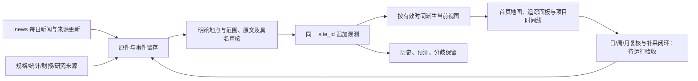

# 站点持续追踪：实施与验收边界

用户要求以土地和物理地点锚定唯一对象，按时间更新业主、开发/建设/运营方、使用方、容量与状态。估算、约数、后续细化属于正常研究输入；新增观测与更正旧事实分开处理。

本批修改：

- `knowledge/site_timeline.py` 负责观测结构、追加与重放、当前值选择和公开历史。项目仍在 `data/projects.json`，不建立并行项目库；通用数值事实仍在 `facts.json`。
- `workflow/project_review.py` 新增 `observation` 写入路径。正常新时点可改变已有字段，旧顶层基线不改；原件哈希、原文定位、实际C3、当前需求、身份和乐观并发仍核验。身份合并/迁址不从此入口实施。
- 舍入须写精度及依据；推导须写算法、原文输入及假设。推导不标成披露，未来预测不并入当期。IT总数、分期和估算性质原子选择；独立分期需不重叠来源断言。
- 年、月和未知时点可以保存，不补造日期。它们暂不自动压过明确有效日的当前观测；日精度冲突保留双方并回退先前无分歧参考。
- 停机、取消和关闭保留站点/历史容量，排除活跃容量汇总。新闻匹配使用当前角色，不能长期停留在旧租户。
- 项目陈旧进入核验队列、公开年龄，不以时间流逝阻断全站发布。首页新增时间线覆盖、估算、基础复核待更新、分歧与实际来源；不把刷新时间伪装观测日期。

验收必须覆盖：乱序到达不倒退、重放不重复、ID冲突拒绝、预测隔离、日期精度、估算保留、容量不重加、暂停排除活跃容量、正常角色变化、身份保护、来源/审核门槛与网页移动端。

仍需完成：跨指标当前视图与按指标容差/区间；更正同一历史时点的显式替代链；日/周/月自动复核、派工、补采、审核采用和发布的真实闭环；R3两个完整样例的正式采用及网站回执；R4原件追溯。不能以本文件或定时生成清单冒充这些工作已经完成。

节奏：先完成本站点写入/展示批次与真实样例，再用实际变更链路接日常新闻复核；每周处理陈旧/分歧，每月复核地点边界和来源覆盖。未接通采集责任保持公开，不生成虚构的已派工或已交付状态。
